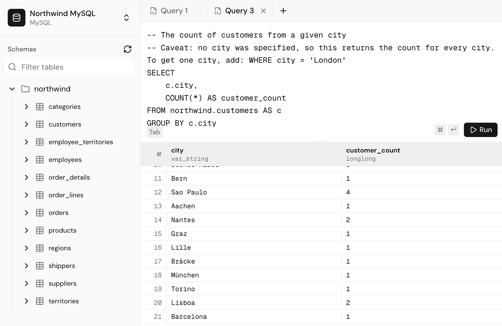
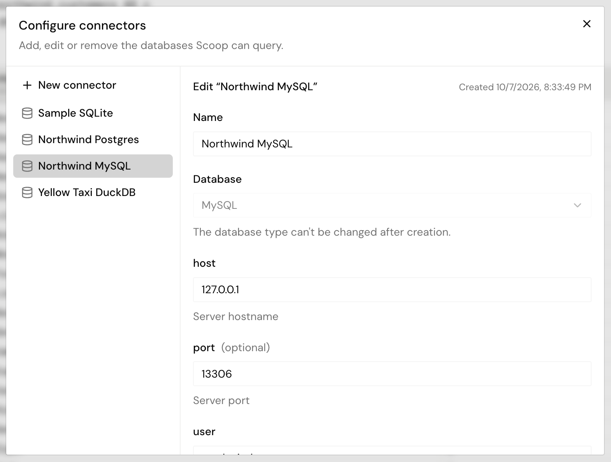

# Scoop

> What's the scoop?

## About

Scoop is an application for connecting to diverse database backends to explore
schemas, tables, and execute queries.



The project is structured in three parts,

```
scoop-api/      # FastAPI server, database connectors, and SQL dialects
scoop-app/      # NextJS application a'la PgAdmin
scoop-types/    # TypeSpec definitions for all APIs & Models, plus the query AST
warehouse/      # Sample NYC yellow-taxi data (yellow.duckdb, yellow.parquet)
```

The project uses `just` for simplified command running. From the repo root,

```
just setup      # Install dependencies for all three packages
just codegen    # Compile the TypeSpec, then regenerate the API models and app types
just docker     # (Re)start the Postgres + MySQL test container on :15432 / :13306
```

Then you can start each component with `just run` and you'll get the following,

```
cd scoop-api && just run        # listening on :8000
cd scoop-app && just run        # listening on :3000
```

## Design

Scoop is able to connect to diverse database backends by means of a single
`Connector` abstraction. This interface allows the HTTP API layer to work
against a shared interface, while the actual implementation for Postgres and
MySQL differs. You will notice that this is the same pattern used by JDBC. Here
is the `Connector` definition.

```python
class Connector(ABC):
    @classmethod
    @abstractmethod
    def kind(cls) -> str: ...                      # e.g. "postgres"

    @classmethod
    @abstractmethod
    def display_name(cls) -> str: ...              # e.g. "PostgreSQL"

    @classmethod
    @abstractmethod
    def options(cls) -> dict[str, Option]: ...     # what it takes to connect

    @classmethod
    @abstractmethod
    def dialect(cls) -> Dialect: ...               # renders a Query AST as this backend's SQL

    @abstractmethod
    def list_tables(self, namespace: TablePath = ()) -> list[TablePath]:
        """List tables and views whose path starts with `namespace`."""

    @abstractmethod
    def get_table(self, path: TablePath) -> Table:
        """Describe a table or view; raises TableNotFoundError if it doesn't exist."""

    @abstractmethod
    def execute(self, query: Query, *, page_size: int = 1000) -> Result:
        """Run `query`, returning pages of at most `page_size` rows."""

    @abstractmethod
    def close(self) -> None: ...
```

Every backend today has a DB-API 2.0 driver, so they share one implementation,
`DbApiConnector`, whose `execute` compiles the query with the dialect and runs it
on a fresh cursor:

```python
class DbApiConnector(Connector):
    def execute(self, query: Query, *, page_size: int = 1000) -> Result:
        sql, params = self.dialect().compile(query)
        cursor = self._cursor()
        cursor.execute(sql, params)
        return CursorResult(cursor, page_size, self._type_name)
```

The `list_tables` and `get_table` APIs allow us to query the information_schema
of the backing database to render the schema and tables in the UI via a
`ListTables` HTTP API, it supports a path for arbitrary namespace/schema nesting
since this is not standardized to two-level.

The more interesting method here is the `execute` method. The `execute` method
takes a `Query` AST (not a SQL string), compiles it to SQL plus bound parameters
using the connector's `Dialect`, runs it on a DB-API cursor, and returns a
`Result` object which is an iterator of `Page`. I chose a columnar layout for
the page so that we need not repeat column names in each row and bloat the JSON.

```python
@dataclass(frozen=True)
class Page:
    """A batch of rows in columnar form: {column_name: [values...]}."""

    columns: list[Column]
    data: dict[str, list[Any]]

    def __len__(self) -> int:
        return len(self.data[self.columns[0].name]) if self.columns else 0


class Result(ABC, Iterator[Page]):
    """An iterator of result pages. Close it when done."""

    @property
    @abstractmethod
    def columns(self) -> list[Column]: ...

    @abstractmethod
    def __next__(self) -> Page: ...

    @abstractmethod
    def close(self) -> None: ...

    def __iter__(self) -> Self:
        return self
```

This lets us write per-database implementations which need only describe
themselves with a few class attributes and implement `list_tables`,
`get_table`, `_cursor`, and `close`. Each backend's file holds both its
connector and its SQL dialect,

```
api/
    connector/
        connector.py    # The interface: Connector, Result, Page, Table, errors
        dbapi.py        # DbApiConnector: shared DB-API 2.0 implementation
        options.py      # Option, and validating options against them
        collect.py      # Result -> JSON-ready columnar rows
        registry.py     # Connector classes keyed by kind; create_connector()
        cache.py        # ConnectorCache: live connectors keyed by id
        sqlite.py       # SQLiteDialect + SQLiteConnector
        duckdb.py       # DuckDBDialect + DuckDBConnector
        postgres.py     # PostgresDialect + PostgresConnector
        mysql.py        # MySQLDialect + MySQLConnector
    sql/
        dialect.py      # ANSI SQL Dialect visitor, with hooks for backends
        doc.py          # Wadler-style layout tree and renderer
        visitor.py      # Visitor base class for the query AST
    models.py           # Generated from scoop-types
```

We have a unified way to query with connectors, but how do we actually
instantiate them? Each connector class declares its `kind`, a `display_name`,
and the `options` it takes, and `create_connector(kind, options)` validates an arbitrary dict
of options (JSON) against them before passing them to `__init__`. For example,
here's the postgres connector's description.

```python
class PostgresConnector(DbApiConnector):
    kind = "postgres"
    display_name = "PostgreSQL"
    options = {
        "host": Option(str, "Server hostname"),
        "port": Option(int, "Server port", default=5432),
        "user": Option(str, "Username"),
        "password": Option(str, "Password", optional=True, secret=True),
        "database": Option(str, "Database name"),
    }
    dialect = PostgresDialect()

    def __init__(self, database: str, **options: Any) -> None:
        self._conn = psycopg.connect(dbname=database, autocommit=True, **options)
```

This pays off in two ways. First, we can make a registry of all connector
classes and create an HTTP API to list all available connectors. Because each
declares its `options`, our UI can render them as a form. Second, we can save
all options JSON into the application database along with the connector kind.
Then when a query comes in we can check a `ConnectorCache` to see if we have an
active connection, otherwise we use the connector kind to look up the class in
the registry and create the connector from the stored options.

### Queries

Queries are represented as a universal `Query` AST defined in
`scoop-types/ast.tsp` and generated into Pydantic models. The AST is a
deliberately minimal, supporting the basic clauses like:

- `SELECT [DISTINCT]`
- `FROM` with joins and derived tables,
- `WHERE`
- `GROUP BY`
- `HAVING`
- `ORDER BY` (with `NULLS FIRST/LAST`)
- `LIMIT/OFFSET`

Then common expressions such as:

  - `CASE WHEN`
  - `CAST`
  - `IN`
  - `BETWEEN`
  - `LIKE`
  - `IS NULL`
  - `COALESCE`
  - `NULLIF`

Turning the AST into SQL is a traversal, so `sql/visitor.py` provides a
`Visitor[C, R]` base class. The generated nodes are closed classes on which we
cannot author an `accept` method, so the visitor dispatches on node type with
`functools.singledispatchmethod`. State flows down the traversal through a
context `ctx: C` and back up through the return value `R`.

The `Dialect` in `dialect.py` is a visitor that renders ANSI SQL. It does not
build strings directly; it returns a Wadler-style `Doc` layout tree (`doc.py`)
which is then rendered to fit a line width, so the generated SQL comes out
pretty-printed. Every literal is bound as a parameter rather than inlined, so
`compile` returns both the SQL and its parameters.

```python
sql, params = PostgresDialect().compile(query)
```

Each connector declares its dialect, e.g. `dialect = PostgresDialect()`, and the
shared `Connector.execute` uses the dialect to compile to the correct SQL
before executing on the connector's backend.

### HTTP APIs

All the HTTP APIs are defined in `scoop-types/scoop.tsp` - we have Connector
CRUD then we have the Connector APIs as HTTP APIs.

```
GET    /v1/health                    # Service health and version
GET    /v1/connector-kinds           # List connector kinds and their options
GET    /v1/connectors                # List saved connectors
POST   /v1/connectors                # Create a connector
GET    /v1/connectors/{id}           # Get a connector
PATCH  /v1/connectors/{id}           # Update a connector
DELETE /v1/connectors/{id}           # Delete a connector
GET    /v1/connectors/{id}/tables    # List tables and views under a namespace
GET    /v1/connectors/{id}/table     # Describe a table or view
POST   /v1/connectors/{id}/execute   # Run a Query AST, returning columnar rows
POST   /v1/connectors/{id}/generate  # Generate SQL from a prompt (SSE stream)
```

The connector-kinds API returns a list of all supported connectors along with their
options. The UI does NOT hardcode any connector information and it's all dynamic
based on the available connectors.



The connector creation saves the connector and its options into the database,
then when we call `execute` we lookup the connector `id` in an object cache. If
the connector is missing from the cache, we instantiate it using the respective
connector class. The `execute` API then sends the `Query` AST to the connector, which
compiles it with its dialect and returns the `Result` object described above.
The HTTP layer converts the `Result` object into a `Page` of JSON results which
the UI renders.

Finally there are end-to-end integration tests against the Docker image containing
the Postgres and MySQL Northwind databases (start it with `just docker`). These
integration tests use the HTTP API to test the full system.

## Prompts

These are my major prompts and where I redirected the AI.

1. Connector Interface

> Our goal is to create a Connector interface for connections to diverse database backends. This should be inspired by JDBC but minimal. We should have metadata APIs for listing tables, getting tables, and then an 'execute' API which takes a query text and returns a 'Result' object (interface) which is an iterator of result pages. Please ask any clarifying questions before continuing.

Comments: Here I knew the exact shape of the API I wanted, and I knew I only
needed minimal metadata and the paginated execute. The clarifying questions is
how I make Claude interview me rather than it making decisions. I had to steer
Claude to get the shape of the Results Page correct by making it columnar rather
than rowwise. I wanted columnar because I knew that I would JSON-ify this later
so wanted a more efficient shape.

2. ConnectorFactory Interface

> Each Connector will require it's own instantiation logic. I want to design a ConnectorFactory which unifies connector instantiation into an interface. This interface should have a 'kind' method and 'name' method, then a method that returns a dict of all the necessary options to instantiate. The instantiation method should take a dict of the options then instantiate the appropriate connector. We do not need to hook this up to any APIs yet.

Comments: I knew that I needed a factory for connectors, and I really cared for
the 'kind' discriminant and 'options' dict. I knew these were going to power
both the UI and the server's connector instantiation. I kept the scope small
because I only wanted the interface + impls. I did not care for hooking this
into any HTTP APIs or even the server. Notably, I do NOT ask for the factory
registry -- that was a major point in the 'kind' choice -- yet Claude put the
registry into the plan and I approved that.

3. HTTP APIs

> Look at connector.py and determine a minimal set of HTTP APIs for Connector CRUD and then interactions with connectors at their scoped endpoints. Each connector will have a UUID so we can address it like '/v1/connector/<uuid>/execute/'

Comments: Once I had the python APIs good, I knew it would be easy for Claude to
raise a set of HTTP APIs. I had already setup the `scoop-types` package with the
codegen, so this was purely writing TypeSpec. I knew I just needed Connector
CRUD with the factories and then an HTTP equivalent of the Connector API which
had already been established. I had to steer the actual implementation of the
Connector CRUD to ensure we stored the connector like, (kind text, options,
jsonb) which Claude did not choose on its own. I wanted this because it's
precisely how we interface with the factory.


4. Connectors in APIs

> Please build a connector cache which cache's a Connector instance by UUID. If there's a cache miss, we lookup in the database and use the respective factory to instantiate this. All connector routes should get the cache via FastAPI dep injection.

Comments: This prompt is how I hooked Connectors into the HTTP API. With this,
each connector route had access to the cache/registry and a means to instantiate
a connector if needed. I was explicit to use the FastAPI dependency injection
patterns to ensure Claude managed state properly. 

5. Scaffold App

> Create a scoop-app NextJS + shadcn project and pull all shadcn components, then configure the scoop-types codegen and create SWR hooks for ALL APIs.

Comments: I used this prompt to scaffold the application. The important thing
was (1) getting ALL shadcn components so we can build without having to pull
each time and (2) configuring codegen and hooks so that we get all models from
the TypeSpec defined earlier and then hooks so we can call the APIs. This prompt
was enough to get a useable application shell. I followed-up by stating to
explore the APIs and recognize this is a PgAdmin like application. That seed was
enough to get a first pass at the UI, with some nudging on where to put
connectors and using a filetree for showing the schemas+tables.

6. Generate AST

> Create an ast.tsp file which is imported by our main .tsp -- we should for now just put a simple
  expression ast in this and ensure we get model compilation wired end-to-end. I want to inspect the
  python ast models.

Comments: I did this to get the AST wired up and to ensure the generated models
were in a shape that I was happy with. Once I liked the setup, then I went for
a minimal AST that still covers a substantial set of functional SQL.

> I want the AST to be a minimal subset of SQL that covers the most number of basic features. We need
> the following clauses:
>
> - select
> - from
> - where
> - group by
> - having
> - limit/offset
>
> Then we should have the ANSI-SQL standard expressions include case-when, coalesce, nullif, etc. Use
> the pareto principle to determine a minimal set of features with maximum coverage. We do NOT need a
> complete SQL AST.


7. Visitor Setup

See visitor.py -- it's nice!

> In scoop-api/api create a 'visitor.py' which is an abstract base class Visitor for the AST. This should use functools dispatch along with parameterized context (ctx: C) and return R.
> Like, visit_node(node: Node, ctx: C) -> R
> Include a test_visitor.py which implements the abc and tests the dispatch for the pattern over all AST nodes.

Comments: For SQL translation, I want to traverse the AST. In an OO language
like python with closed objects like the generated AST nodes, this calls for the
visitor pattern. I used a python trick for dispatching on types since we cannot
author an `accept` method on the generated nodes. This allows me to author a
top-level visit method which dispatches to different methods based on node type
without having to go through the objects. I use a context variable and typed
returned because this completes all ways to pass state in a traversal, either
up the call stack via returns or down the call stack via ctx -- both work great
without having to keep any state outside the traversal.


8. SQL Dialects

>  I want you to author a 'Dialect' visitor in a new 'sql' module which is an implementation of the
  Visitor which pretty-prints SQL. It should use a Wadler-style intermediate data structure for layout.
  We must also be able to do per-dialect overrides.

Comments: To turn the AST back into dialect-specific SQL, we can use our visitor
and have it return a string. I wanted a Wadler pretty-printer so that we can get
some pretty-printing; this basically takes the AST and puts it into a 'document'
tree which then is rendered to a string.


## Future Work

1. Connection Pools

The current setup has only one connector instance that gets re-used by
all queries. I made no attempts at thread safety or being able to handle
concurrent requests. The design is simple and pragmatic, but limited.

2. Proper Cursor Handling

This implementation does not have proper pagination in the API because
it would required pagination tokens and holding cursors in memory. The
pragmatic solution was to cap at 10,000 results and paginate client-side
in the application. This is sufficient for a user-facing application, but
not if the customer truly needs to export all results. I would need to
hold cursors (the Result abstraction) and make the HTTP API's pagination
work with the cursor/Result API.

3. Passwords in the database!!

I made no attempts for proper secret management. We cannot store secrets in the
database. In a proper system, I would store placeholders, like keys, in the
database and use a service like AWS Secrets Manager to load the secrets on the
server during connector instantiation. `create_connector` would have
access to a SecretsStore object on which they could resolve the placeholder keys
to the actual secrets before doing a proper connect.

4. Proper Value Encoding

As a shortcut, I just quickly JSON-ified all results, but I know that not all
SQL types are JSON-serializable such as BLOBs. Also, SQL has INTs 128-bit which
are larger than JSON INT (64-bit) yet I made no attempt to have robust value
encoding. Of course, it's mostly good and in 45 minutes it did the trick.

5. User-Supplied Parameters

Each backend uses different syntax for parameters like `?` vs. `%s`. The query
AST now solves this for literals: each `Dialect` binds every literal as a
parameter and emits its own placeholder style. What's missing is a way for users
to supply their own named parameters (e.g. a `ParamExpr` node bound at execute
time), since the `execute` API takes only the `Query` AST.

6. Additional Query Syntax

I have left out CTEs, UNION/INTERSECT/EXCEPT, OVER, subqueries, and many other
forms. I explicitly did not want a complete SQL AST and to massively increase
the scope in the short amount of time allotted. These would be straightforward
to add to the AST and visitor for dialect translations.

## Support

Scoop currently supports the following database backends. Each one is a
connector in `scoop-api/api/connector/`, registered by its `kind` in
`registry.py`.

| Backend    | Kind       | Library            |
|------------|------------|--------------------|
| DuckDB     | `duckdb`   | `duckdb`           |
| PostgreSQL | `postgres` | `psycopg` 3        |
| SQLite     | `sqlite`   | `sqlite3` (stdlib) |
| MySQL      | `mysql`    | `PyMySQL`          |
